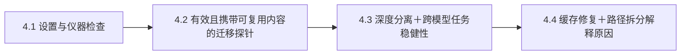

# Still Needed, Hard to Transfer：机制结果整合版

标题：**Still Needed, Hard to Transfer: Using and Reusing Contextual Skills**。

## 使用文件

上传 `StillNeeded-overleaf.zip` 到 Overleaf 的 New Project → Upload Project。
主文件为根目录 `main.tex`，编译器 pdfLaTeX，参考文献 BibTeX。
`StillNeeded-review.pdf` 来自对同一 ZIP 的独立编译。
`project/` 只包含编译所需源码、PDF图和参考文献，无实验日志、脚本或缓存。
将 `\extendedappendixfalse` 改为 `\extendedappendixtrue` 可编译扩展版。
原桌面审阅目录保持不变；本目录是另行导出的结果整合版。

## 引言的关键句与三条贡献

模型按新规则完成任务时，获得的是可以提取复用的内部技能，还是依托原说明与计算过程才能发挥作用的能力？
单看答对任务无法区分这两者。我们把“移植状态还能否发挥作用”和“原执行是否还需要来源”放在一起测量。
发现技能状态的迁移先减弱，而原计算继续依赖规则；进一步发现，补齐源端缓存能够恢复一部分晚层迁移，但恢复后仍需读取规则。

三条贡献对应正文英文措辞：

1. **建立经验证的内部技能复用探针。** 在规则本身的位置移植状态能恢复技能效果；内容、位置与跨题控制说明迁移携带了结构化技能信息。
2. **揭示技能迁移与来源使用沿深度分离。** 三个模型、两个任务以及共同题目上的复核，均出现“仍需来源，但状态已难迁移”的区间。
3. **通过因果干预检验计算历史与继续读取的作用。** 状态与缓存联合修复恢复显著晚层迁移；再次切断读取会损害恢复效果，路径拆分确认晚层依赖来自持续读取。

## 实验章节的新顺序

按本轮建议整理为四节，原有证据全部保留：

- **4.1 设置**：任务、模型、样本与自身状态写回检查。
- **4.2 验证探针**：合并原4.2与4.5。先证明来源位置干预有效，再通过内容和跨题对照确认不是只搬运当前答案。
- **4.3 主现象与稳健性**：原4.3合并原4.6的跨模型/任务复现，并纳入共同样本、阈值和重复注入检查。
- **4.4 探究原因**：联合修复源端状态与缓存，再切断读取；区分题目读取规则和规则内部更新。

## 四张图分别说明什么

1. **Fig.1 首页teaser**：问题、两种干预、真实深度曲线。让读者先理解“使用”和“复用”是不同问题。
2. **Fig.2 位置与内容对照**：在规则自身的位置移植有效，末位置等对照效果弱；证明主要测量工具有效。
3. **Fig.3 六组深度曲线**：三个模型、两个任务都存在迁移先减弱的现象。配套表检查同题分母和复现范围。
4. **Fig.4 两块真实热力图**：左边是四种修复×四个层号的正确率；右边是三种切断×三个层号导致的正确率损失。两图都来自同114题、14个计算器，所有格子都已测量。

## 新结果的直观解释

本次新增推理仅为 **Qwen3-8B + MedCalc**。固定124题分四张4090完成，使用新基线筛出114题：正确规则能答对，错误规则与无规则均答错。

- **S**：只移植规则位置的内部状态。
- **C**：只移植规则之前计算留下的注意力键值缓存。
- **SC**：同时移植两者。
- **SC + recut**：联合修复后，从下一层开始禁止题目继续读取规则。

第16层：S答对4/114（3.5%），C答对8/114（7.0%），SC答对48/114（42.1%），SC再切断读取只答对8/114（7.0%）。
这说明失败的残差移植遗漏了重要计算历史；补齐历史能明显修复，却没有把技能变成脱离来源的独立能力。
按计算器整组重采样（保留同类题目之间的相关性）得到联合修复增益的95%区间为26.6–46.5个百分点。

第24层的原正确执行中：只切断题目对规则的读取，保留29/114（25.4%）；只切断规则内部更新，保留110/114（96.5%）。因此晚层仍然需要的是读取规则。

第24层联合修复后的再次切断没有额外损失，且长输出截断较多，不将第16层的修复后读取结论外推到所有层。
关键第16层修复增益和第24层路径差，在把截断样本作最不利处理后仍保持，因此本次不为完稿追加生成或扩展模型实验。
接收端题目状态替换保留为后续研究，不写成本次已经验证的机制。

## 最终结论

**上下文技能的有效使用，与内部状态的独立复用，是两种不同性质。状态移植失败不代表技能信息已经消失；迁移恢复也不代表原说明已经不再需要。计算历史和持续来源访问，共同约束了上下文能力的可移植性。**
